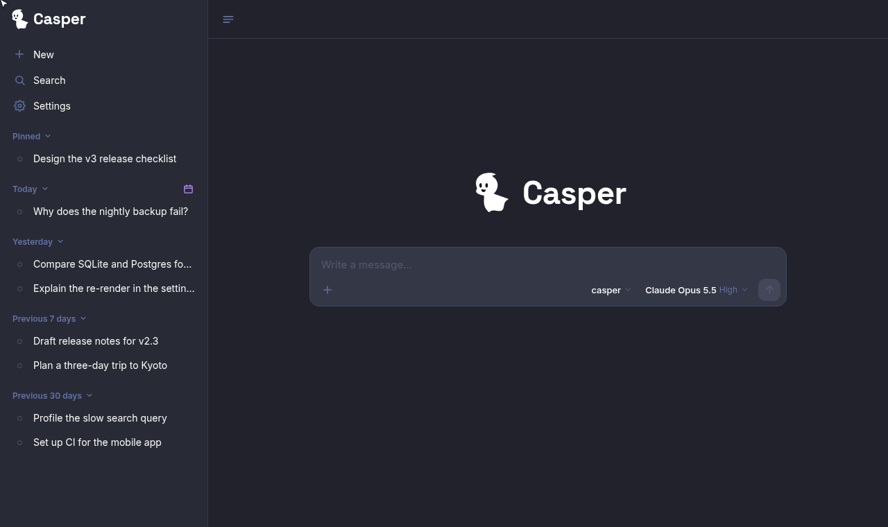

<p align="center">

</p>

<p align="center">
<a href="https://github.com/joeyshi12/casper/blob/main/LICENSE"></a>
<a href="https://www.npmjs.com/package/@joeyshi12/casper"></a>
<a href="https://github.com/joeyshi12/casper/actions/workflows/test.yml"></a>
<a href="https://github.com/joeyshi12/casper/actions/workflows/publish.yml"></a>
</p>

A web client for `kiro-cli`, over its Agent Client Protocol (ACP). Start a long
Kiro task and it keeps running server-side; on reconnect the client replays
exactly what it missed.

<p align="center">

</p>

## Features

- **Chats** you can search, rename, pin, group by date, edit and branch. Idle ones go
  dormant and resume on demand.
- **Model, effort and agent** per chat, with titles from kiro and live context usage
  and credits.
- **Rich rendering** of Markdown, Mermaid, code and tool calls, a file browser for the
  workspace, subagent transcripts, inline widgets from a `show_widget` MCP tool, and
  options from a `show_choice` tool that wait for you to tap one or type a reply.
- **Settings** for kiro's defaults, MCP servers and skills, and your logged-in devices.
- **PWA** that installs to a home screen.

## Install

Needs Node 24+ and [`kiro-cli`](https://kiro.dev) 3.x, installed and logged in.

```bash
npm install -g @joeyshi12/casper
casper                     # prints an access token and the URL to open
casper service install     # optional: a systemd user service that survives reboots
```

| Command | |
|---|---|
| `casper token` | Print the access token |
| `casper reset-token [value]` | Set a new token and sign every device out |
| `casper doctor` | Check kiro-cli, settings, data directory, web app and MCP server |
| `casper mcp` | Run the widget MCP server on stdio (kiro spawns this for you) |
| `casper service install \| uninstall \| status` | Manage the systemd user service |

The `casper` agent gets the widget tools. To give them to another agent:
`kiro-cli mcp add --name casper --agent <agent> --command casper --args mcp`.

To update, install `@joeyshi12/casper@latest` and re-run `casper service install`,
since the unit records paths that move on upgrade. To remove it, run
`casper service uninstall`, `npm uninstall -g @joeyshi12/casper`, and delete
`~/.casper` and `~/.config/casper` if you want the data gone.

## Configuration

Settings live in `~/.config/casper/config.json` (written `0600`). Each also works as
an environment variable, and the environment wins.

| Variable | Config key | Default | |
|---|---|---|---|
| `HOST` | `host` | `0.0.0.0` | Bind address |
| `PORT` | `port` | `4319` | Server port |
| `CASPER_TOKEN` | `token` | _(generated)_ | Exchanged at login for a per-device cookie |
| `CASPER_SESSION_TTL_SECONDS` | `sessionTtlSeconds` | `604800` | Device-login lifetime, extended on activity |
| `KIRO_BIN` | `kiroBin` | `kiro-cli` | Path to kiro-cli |
| `CASPER_KIRO_SESSIONS_DIR` | `kiroSessionsDir` | `~/.kiro/sessions` | kiro's session files, which Casper reads |
| `DEFAULT_CWD` | `defaultCwd` | cwd | Working directory for new chats |
| `DEFAULT_AGENT` | `defaultAgent` | `casper` | Agent for new chats when kiro's `chat.defaultAgent` is unset |
| `CASPER_FILE_ROOT` | `fileRoot` | `/` | The only folder the file browser can read |
| `MAX_LIVE_SESSIONS` | `maxLiveSessions` | `6` | Concurrent kiro processes |
| `EVENT_BUFFER_SIZE` | `eventBufferSize` | `5000` | Events kept per chat for replay on reconnect |
| `CASPER_MAX_UPLOAD_BYTES` | `maxUploadBytes` | `104857600` | Largest uploaded file |
| `CASPER_DATA_DIR` | _(env only)_ | `~/.casper` | Where `casper.db` and uploads live |
| `CASPER_WEB_DIST` | _(env only)_ | beside the bundle | Built web app to serve |

Beyond your LAN, put a TLS reverse proxy in front that forwards WebSocket upgrades
with a long read timeout. The PWA needs HTTPS.

## Security

Casper allows every tool call kiro asks about, once, so treat access to Casper as a
shell on the machine. kiro's deny rules still apply, and no "always allow" rule is
saved. The token is stored only as a hash, and `/api/login` allows ten failures per
quarter hour per address.

## Develop

```bash
npm install
CASPER_TOKEN=dev npm run dev   # server and web dev servers together
npm test
npm run e2e                    # prompt, disconnect mid-turn, reconnect, replay
```

`shared/` holds the types, `web/` the React app, and `server/` the published package.
See [AGENTS.md](AGENTS.md) for the rest.
